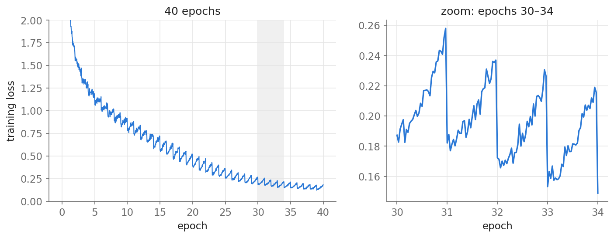
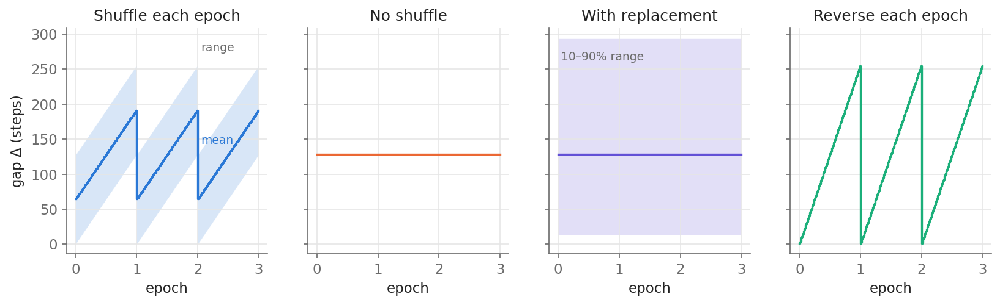
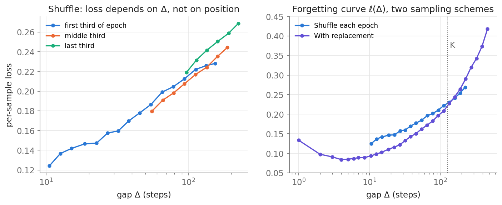
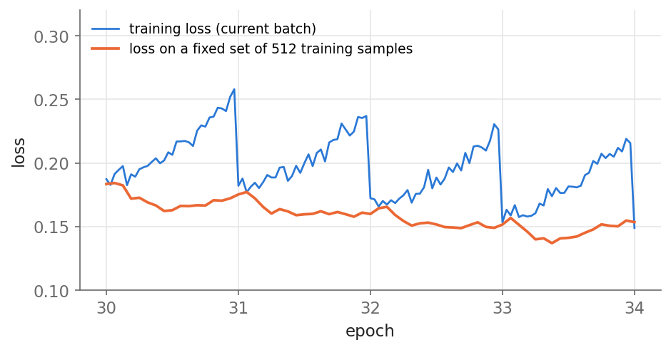
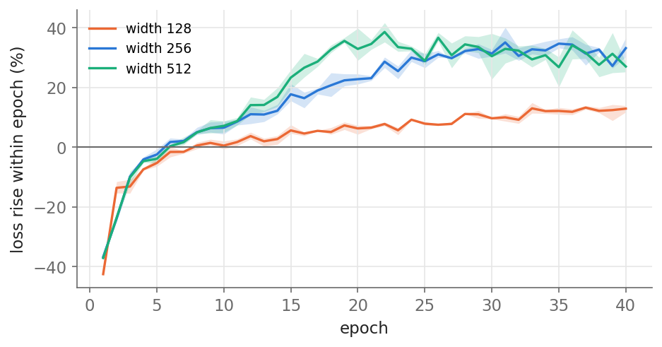

## 1. A very odd loss curve

<figure>
  
  <figcaption><strong>The epochal sawtooth.</strong> Training loss of a 3M-parameter byte-level GPT, Adam, shuffled every epoch. The loss creeps up within each epoch and drops at the next.</figcaption>
</figure>

When a model is trained for many epochs with per-epoch shuffling, the training loss often rises slowly within each epoch and drops abruptly at every epoch boundary. We have seen curves like this before, and they are not a bug; others have reported them too, for example when fine-tuning LLMs, and attributed them to the model memorizing examples after seeing them only once [1]. Prior work [2] studied the pattern systematically and named it the **Epochal Sawtooth Phenomenon (ESP)**. They observed it in BERT pretraining, found it strongest with Adam, and showed that it is sensitive to how the data is sampled, to Adam's $\beta_2$, and to model size.

Their explanation centers on the optimizer: Adam's momentum and its per-coordinate normalization by $\sqrt{v_t}$ make training on other batches slowly raise the loss of a batch not yet visited (Section 2). But it leaves the most striking ablations unexplained: why turning off shuffling weakens the sawtooth, and why sampling with replacement removes it.

Here we take a different angle, and those unexplained ablations are the clue. Turning off shuffling, sampling with replacement, reversing the order every epoch and changing the batch size all leave the optimizer untouched; they change only the order in which samples are seen. If the order alone can make the sawtooth disappear or amplify it, the key variable should be a quantity determined by the order, not an optimizer statistic. Since neural networks memorize the specific samples they train on and gradually forget them afterwards, a natural candidate is how long ago each sample was last trained on. This leads to a more principled explanation that does not rely on the optimizer: the sawtooth comes from **what** the training loss measures. Each step's loss is computed on samples of different "freshness", and the average freshness, the **expected gap** since the last visit, follows a sawtooth over the epoch. We derive the shape of the curve, predict the outcome of all four sampling ablations, and verify the mechanism with a small GPT.

## 2. Background: the optimizer-based explanation

Liu and Ma [2] trace the sawtooth to Adam. Two observations point there: the sawtooth is strongest with Adam and weaker with RMSProp, and it becomes more pronounced as $\beta_2$ decreases. Recall that, with gradient $g_t$ and learning rate $\gamma$, Adam updates

$$
\begin{aligned}
m_t &= \beta_1 m_{t-1} + (1-\beta_1)\, g_t, \\
v_t &= \beta_2 v_{t-1} + (1-\beta_2)\, g_t^2, \\
\theta_t &= \theta_{t-1} - \gamma\, \frac{m_t}{\sqrt{v_t} + \epsilon}.
\end{aligned}
$$

Their argument has two parts, one for each side of the sawtooth.

**The drop at the start of an epoch.** After reshuffling, the last batches of one epoch overlap with the first batches of the next, so the momentum $m_t$ is large at the start of an epoch and the model takes large steps on its first few batches.

**The rise during the epoch.** Let $l_t^b$ be the loss of batch $b$ at step $t$ and $\Delta\theta_t = \theta_t - \theta_{t-1}$. Before $b$ is visited, to first order

$$
l_t^b \approx l_0 + \sum_{\tau=0}^{t-1} \left\langle \Delta\theta_\tau,\ \nabla l_\tau^b \right\rangle,
$$

where $l_0$ is the loss at the start of the epoch. The gradients of other batches point roughly along $\nabla l^b$, but the per-coordinate division by $\sqrt{v_t}$ rotates the update. For $\beta_2$ not close to 1 the inner product tends to be positive, so the loss of $b$ slowly rises until $b$ is trained on.

This explains why a smaller $\beta_2$ strengthens the sawtooth, but it has two limitations. First, it is not derived from first principles: it relies on empirical fits to how $\lVert g_t\rVert$, $\lVert m_t\rVert$ and $\lVert v_t\rVert$ evolve within an epoch. Second, it does not explain the effect of sampling: the authors acknowledge that their analysis explains neither the effect of shuffling nor that of sampling with replacement.

## 3. A new perspective: the gap since last training

Consider a dataset of $N$ samples, batch size $B$, and $K = N/B$ steps per epoch, and index the step within an epoch by $q \in \{0, 1, \dots, K-1\}$. For a sample in the current batch, define its **gap** $\Delta$ as the number of steps since it was last trained on. The training loss logged at step $q$ is computed on the current batch *before* the update, so it is an average of per-sample losses, each at its own gap.

**Forgetting curve.** Let $\ell(\Delta)$ be the expected loss of a sample whose gap is $\Delta$; we assume

$$
\ell(\Delta) \ \text{is increasing in}\ \Delta.
$$

That is, the model retains something specific about each sample it trains on: training on a sample lowers its loss, and training on other samples afterwards partly undoes that. The same effect has been studied as *example forgetting* [3], and we measure $\ell(\Delta)$ directly in Section 5.1.

**How the gap behaves within an epoch.** With an independent shuffle every epoch and no replacement, the sample at step $q$ of this epoch sat at a position $p$ in the previous epoch that is uniform on $\{0,\dots,K-1\}$ and independent of $q$. Its gap is the rest of the previous epoch plus the part of this epoch already done:

$$
\Delta = (K - p) + q .
$$

Averaging over $p$,

$$
\mathbb{E}[\Delta \mid q] = \frac{K+1}{2} + q \approx \frac{K}{2} + q .
$$

**Within an epoch, the expected gap grows linearly from about $K/2$ to about $3K/2$; at the next epoch it falls back to about $K/2$.** Since $\ell$ is increasing, the training loss rises through the epoch and drops at the boundary. Intuitively, the first batches of an epoch are mostly samples from the second half of the previous epoch, which the model saw recently; the last batches include many samples from the start of the previous epoch, which the model saw long ago.

Strictly, the logged loss is the average of $\ell(\Delta)$ over the batch, not $\ell$ of the average gap. This makes no difference here: given $q$, $\Delta$ is uniform on $\{q+1, \dots, q+K\}$, so each step shifts the whole distribution of gaps up by one, and the average loss rises with it.

This also covers the first part of the optimizer-based explanation, that the first batches of an epoch overlap with the last batches of the previous one. In terms of gaps, these samples simply have the smallest gaps, and therefore the lowest loss.

## 4. The gap explains the sampling ablations

We now check this perspective against the sampling ablations in [2]. For each scheme, we work out the gap $\Delta$ at step $q$: if it changes with $q$, we predict a sawtooth, otherwise none. We compare each prediction with [2] and with our own runs.

**Setup.** A byte-level GPT (4 layers, width 256, 3.3M parameters) is trained on 4,096 sequences of 128 bytes from TinyStories [4] for 40 epochs, with batch size 32 ($K = 128$) and Adam (learning rate $10^{-3}$, $\beta=(0.9, 0.999)$), a small analogue of the BERT setting in [2]. The sawtooth is measured as the change from the first 10% to the last 10% of steps of each epoch, averaged over epochs 25–34 and 3 seeds. Code: **[liqq010/esp](https://github.com/liqq010/esp)**.

The two figures below are aligned column by column: the first shows the gap under each scheme, the second the training loss of the same model under that scheme. Under shuffling, the expected gap grows within each epoch, and the loss rises by **32%** within each epoch.

<figure>
  
  <figcaption><strong>Gap Δ under each scheme</strong> (K = 128). Line: mean; band: range of Δ (for sampling with replacement, whose geometric distribution is unbounded, the 10th–90th percentiles).</figcaption>
</figure>

<figure>
  
  <figcaption><strong>Training loss under each scheme</strong> (epochs 30–34, shared y axis). The loss follows the gap.</figcaption>
</figure>

**No shuffling.** Every sample keeps the same position in every epoch, $p = q$, so $\Delta = K$ for all samples at every step. The gap does not depend on $q$, and the sawtooth should disappear. Indeed, [2] finds it nearly gone; the weak residual can come from second-order effects such as samples at different positions having different difficulty. In our runs the loss falls by 6% within each epoch: no sawtooth, only the model improving.

**Sampling with replacement.** Each step draws $B$ samples independently from the whole dataset. The time since a sample was last drawn is geometric with mean $K$, and its distribution is the same at every step. There is no epoch in any meaningful sense, and the sawtooth should disappear, as [2] observes. In our runs the loss falls by 4% within each epoch.

**Reversing the order every epoch** (order A, then reversed A, then A, …). The sample at step $q$ sat at position $K-1-q$ in the previous epoch, so

$$
\Delta = (K - (K-1-q)) + q = 1 + 2q .
$$

The gap now runs from 1 to about $2K$, twice the range under shuffling, and the first samples of an epoch were trained on one step ago. The sawtooth should be about twice as large, consistent with the strong amplification reported in [2]. In our runs the loss rises by **64%** within each epoch, twice the 32% under shuffling.

**Larger batch size.** With a larger batch, an epoch has fewer steps $K$, so the range of gaps, measured in steps, shrinks. In addition, each step fits any individual sample less. Both effects weaken the sawtooth, as [2] reports. In our runs, batch sizes 16, 32, 64 and 128 give rises of 36%, 32%, 27% and 16%. The ordering also holds when runs are compared at the same training loss, so it is not just that larger batches train more slowly.

All four ablations follow directly from this one derivation, while the optimizer-based analysis of [2] leaves two of them, no shuffling and sampling with replacement, unexplained.

## 5. Further experiments

The sampling ablations test what the gap predicts. The experiments below test the mechanism itself, using the runs of Section 4 and, in Section 5.3, two more model widths. At every step we record, for each sample in the batch, its loss and its gap $\Delta$, and every 8 steps we evaluate the model on a fixed set of 512 training samples.

### 5.1 Measuring the forgetting curve

<figure>
  
  <figcaption><strong>Per-sample loss against the gap Δ</strong> (epochs 25–34). <em>Left:</em> shuffling, split by position in the epoch; the three curves nearly coincide. <em>Right:</em> shuffling vs. sampling with replacement; the curves have the same shape. Gaps below about 10 are too rare under shuffling to plot.</figcaption>
</figure>

The assumption of Section 3 can be checked directly. Binning every per-sample loss by its gap gives a smooth, increasing curve, from about 0.12 at $\Delta \approx 10$ to about 0.27 at $\Delta \approx 200$. Splitting by position in the epoch (left) tests whether the gap is really the variable that matters. Samples from the first, middle and last third of the epoch cover different ranges of $\Delta$, but where they overlap they follow nearly the same curve, with residual offsets of about 0.01 against a total range of 0.15. The sawtooth is this curve read along a moving window of gaps.

### 5.2 The model is not getting worse

<figure>
  
  <figcaption><strong>Batch loss vs. loss on a fixed set of 512 training samples</strong> (shuffling, epochs 30–34). Only the batch loss shows the sawtooth.</figcaption>
</figure>

If the sawtooth is a measurement effect, a measurement that does not change its samples should not show it. Evaluating the same model on a fixed set of 512 training samples gives a smooth curve that keeps decreasing within each epoch (−7% from the start to the end of an epoch, against +32% for the batch loss). Within an epoch the model improves; only the samples being measured change.

### 5.3 Larger models forget more visibly

<figure>
  
  <figcaption><strong>Sawtooth size over training for three model widths</strong> (0.9M, 3.3M and 12.9M parameters; shaded: range over 3 seeds). It grows as the model starts to memorize, and it is larger for wider models.</figcaption>
</figure>

The gap fixes the *shape* of the sawtooth; the forgetting curve sets its *size*. A model that retains more about individual samples has a steeper $\ell(\Delta)$ and a bigger sawtooth. Two observations support this. First, the sawtooth grows over training: in the first few epochs the loss falls within each epoch, because general learning dominates, and the rise appears only once the model starts fitting individual sequences. Second, it is larger for larger models: at epoch 15 the rise is +6%, +18% and +23% for widths 128, 256 and 512, consistent with the model-size result in [2].

## 6. Discussion

**What the sawtooth tells you.** The sawtooth is not the model degrading within an epoch. It is a sign that the model fits individual training samples, and its amplitude is a rough measure of how much. That is not overfitting by itself; overfitting is a question about held-out data. But in small-data, many-epoch regimes, a sawtooth that suddenly grows is a good reason to look at the validation loss.

**Getting a smooth curve.** Sampling with replacement removes the sawtooth. Larger batches or stronger data augmentation flatten the forgetting curve and shrink it. Logging the loss on a fixed subset of training data, as in Section 5.2, gives a smooth curve without changing training.

**Where Adam comes in: conjectures.** The optimizer can change the sawtooth only through the steepness of the forgetting curve $\ell(\Delta)$ (Section 5.3). Apart from a quick $\beta_2$ sweep, we have not tested the following; they are plausible readings, not results.

- *Adam vs. SGD.* Adam divides each coordinate's update by $\sqrt{v_t}$. Coordinates whose gradients are usually small and are driven by only a few samples, such as embeddings of rare tokens or parameters that respond to specific inputs, get their updates amplified. Adam would then fit individual samples more strongly in a single step, giving a steeper forgetting curve.
- *Smaller $\beta_2$.* $v_t$ averages over roughly $1/(1-\beta_2)$ steps. With a smaller $\beta_2$, $v_t$ is closer to the current $g_t^2$ and the update approaches $\mathrm{sign}(g_t)$, so each step fits the current batch more aggressively and interferes more with other samples, and samples would be memorized and forgotten faster. In our runs, however, this effect is weak: $\beta_2$ from 0.999 down to 0.8 gives rises of 32–35%, and 0.7 gives 28%. The strong $\beta_2$ effect in [2] may depend on the setting.
- *Larger weight decay.* It limits how far parameters can move to fit an individual sample, which would weaken memorization slightly, matching the small effect seen in [2].

## 7. Conclusion

The epochal sawtooth comes from what the training loss measures. Each step's loss is taken on samples whose time since the last visit averages $K/2 + q$, a quantity that itself follows a sawtooth over epochs. If a sample's loss grows with that time, this predicts the shape of the curve and the outcome of every sampling ablation, and a small GPT confirms each prediction. The optimizer and the model determine how steep the forgetting curve is; the sampling scheme alone determines the sawtooth's shape.

## Citation

If you find this post useful, please cite it as:

> Li, Quanquan. "Why Training Loss Sawtooths Across Epochs." *Quanquan Li's blog*, October 15, 2026. https://liqq010.github.io/posts/epochal-sawtooth/

Or in BibTeX:

```bibtex
@misc{li2026epochalsawtooth,
  author       = {Li, Quanquan},
  title        = {Why Training Loss Sawtooths Across Epochs},
  year         = {2026},
  month        = {October},
  day          = {15},
  howpublished = {\url{https://liqq010.github.io/posts/epochal-sawtooth/}},
  note         = {Blog post}
}
```

## References

1. Howard & Whitaker. [Can LLMs learn from a single example?](https://www.fast.ai/posts/2023-09-04-learning-jumps/). fast.ai blog, 2023.
2. Liu & Ma. [The Epochal Sawtooth Phenomenon: Unveiling Training Loss Oscillations in Adam and Other Optimizers](https://arxiv.org/abs/2410.10056). *Neural Processing Letters*, 2025. Code: [qiliuchn/training-loss-pattern](https://github.com/qiliuchn/training-loss-pattern).
3. Toneva et al. [An Empirical Study of Example Forgetting during Deep Neural Network Learning](https://arxiv.org/abs/1812.05159). ICLR 2019.
4. Eldan & Li. [TinyStories: How Small Can Language Models Be and Still Speak Coherent English?](https://arxiv.org/abs/2305.07759). 2023.
