## TL;DR
<figure>
  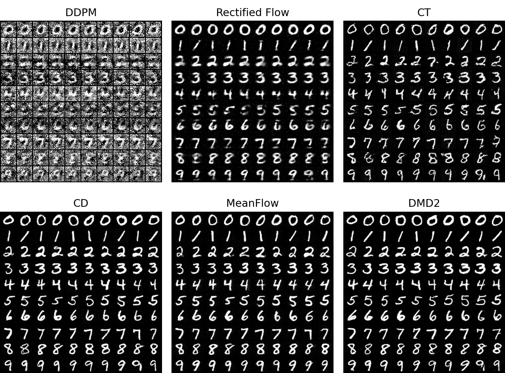
  <figcaption><strong>One-step generated samples</strong>, same initial noise for every method. CT has no guidance, others use classifier-free guidance with scale 3.</figcaption>
</figure>

> What I cannot create, I do not understand.
>
> — Richard Feynman

Knowing how a method works is not the same as understanding it. Understanding means being able to start from first principles and build it, or derive it, yourself. So I implemented diffusion and flow models from scratch, from the original 1000-step DDPM all the way down to 1-step generators, and put them in one repo: **[nano_diffusion](https://github.com/liqq010/nano_diffusion)**, a clean, minimal PyTorch implementation of diffusion and flow models.

### What's covered 

DDPM (ε / x₀ / v-prediction) with DDIM, DPM-Solver-2, DPM-Solver++(2M) and UniPC samplers; Rectified Flow; Consistency Models (CT and CD); MeanFlow; DMD2; and LoRA fine-tuning on top. One small DiT (9.79M parameters), one dataset (MNIST), one time convention shared by every few-step method, and one evaluation protocol (same seed, same initial noise). The core of each method is a single file of under 200 lines of PyTorch, and every model trains on a single GPU in 30 minutes.


### The roadmap

The post follows the number of sampling steps down, and each stop answers one question: *why can we get away with fewer steps?*




<div class="callout">

**Setup used everywhere.** DiT with 28×28 input, patch size 2, hidden size 256, depth 8, 16 heads (9.79M parameters). MNIST train + test (70k images) scaled to $[-1, 1]$. AdamW, batch size 256 (50 for the small LoRA dataset). All models are class-conditional; with classifier-free guidance drop the label 10% of the time during training.

</div>

## Part 1 — The 1000-step Baseline: DDPM

Every method in this post is a variation on one idea from DDPM ([Ho et al., 2020](https://arxiv.org/abs/2006.11239)): destroying an image with noise is trivial, so train a network to undo it, a little at a time.

### Adding noise is easy

The forward process gradually mixes an image $x_0$ with Gaussian noise $\epsilon \sim \mathcal{N}(0, I)$ over $T = 1000$ steps. Each step adds a little noise with variance $\beta_t$, and we can jump straight to any step $t$:

$$
x_t = \sqrt{\bar\alpha_t}\, x_0 + \sqrt{1 - \bar\alpha_t}\, \epsilon, \qquad \bar\alpha_t = \prod_{s=1}^{t} (1 - \beta_s).
$$

$\sqrt{\bar\alpha_t}$ is how much of the image survives, and $\sqrt{1-\bar\alpha_t}$ is how much noise has been mixed in.

Sweeping $t$ from 0 to 1000 traces the full path from image to noise:

<figure>
  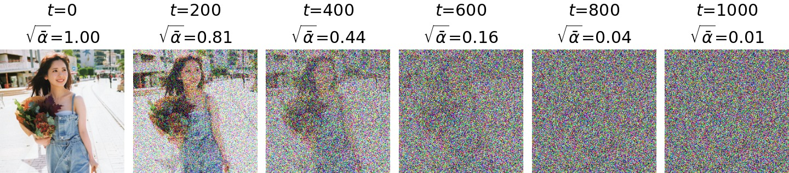
  <figcaption>The forward process with the linear schedule, sampled every 200 steps. All panels use the same $\epsilon$.</figcaption>
</figure>

```python
def q_sample(self, x0, t, noise):
    abar_t = self.abar[t].view(-1, 1, 1, 1)
    return abar_t.sqrt() * x0 + (1 - abar_t).sqrt() * noise
```

### Linear vs cosine schedules

The *schedule* $\beta_1, \dots, \beta_T$ decides how fast the image disappears. The original DDPM uses a linear schedule, $\beta_t$ from $10^{-4}$ to $0.02$. Improved DDPM ([Nichol & Dhariwal, 2021](https://arxiv.org/abs/2102.09672)) noticed that this destroys the image too early and proposed a cosine schedule, which defines $\bar\alpha_t$ directly as a squared cosine:

$$
\bar\alpha_t = \frac{f(t)}{f(0)}, \qquad f(t) = \cos^2\!\left(\frac{t/T + s}{1 + s} \cdot \frac{\pi}{2}\right), \quad s = 0.008.
$$

<figure>
  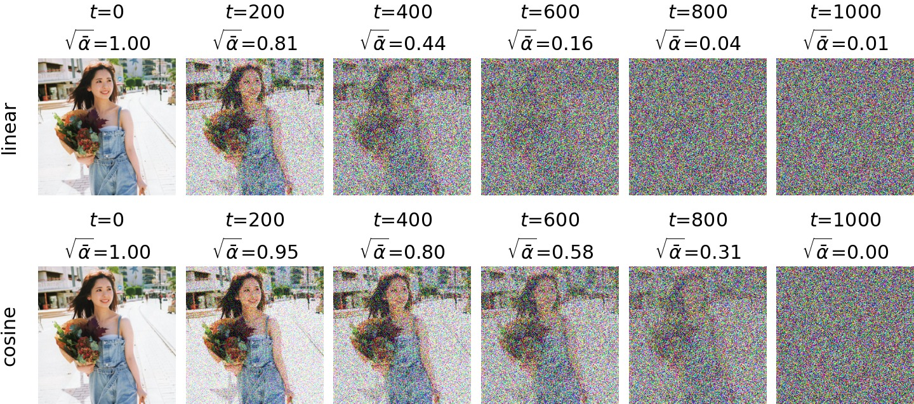
  <figcaption>Top: linear. Bottom: cosine. Same image, same noise. With the linear schedule the person is nearly gone by $t = 600$ ($\sqrt{\bar\alpha} = 0.16$), so the last 40% of the steps are spent on what is essentially pure noise. With the cosine schedule the silhouette survives until about $t = 800$.</figcaption>
</figure>


### Training: what should the network predict?

Training is plain regression. Sample an image, a timestep and some noise, build $x_t$, and ask the network to predict something about it. The original choice is to predict noise $\epsilon$:

```python
def loss(self, model, x0, cond):
    t = torch.randint(0, self.T, (x0.shape[0],), device=x0.device)
    noise = torch.randn_like(x0)
    xt = self.q_sample(x0, t, noise)
    pred = model(xt, t, cond)
    if self.pred == 'eps':
        target = noise
    elif self.pred == 'x0':
        target = x0
    else:  # v = sqrt(abar) * eps - sqrt(1 - abar) * x0
        abar_t = self.abar[t].view(-1, 1, 1, 1)
        target = abar_t.sqrt() * noise - (1 - abar_t).sqrt() * x0
    return F.mse_loss(pred, target)
```

But $\epsilon$ is not the only option. Given $x_t$, the three common targets are interchangeable, since knowing any one of them pins down the other two:

| Target | Network predicts | Recovering $x_0$ |
|---|---|---|
| ε-prediction | $\epsilon$ | $x_0 = \big(x_t - \sqrt{1-\bar\alpha_t}\,\hat\epsilon\big) / \sqrt{\bar\alpha_t}$ |
| x₀-prediction | $x_0$ | directly |
| v-prediction ([Salimans & Ho, 2022](https://arxiv.org/abs/2202.00512)) | $v = \sqrt{\bar\alpha_t}\,\epsilon - \sqrt{1-\bar\alpha_t}\,x_0$ | $x_0 = \sqrt{\bar\alpha_t}\,x_t - \sqrt{1-\bar\alpha_t}\,\hat v$ |

They are equivalent *in theory*. In practice they differ in how the network's error is scaled when it is turned into an image, and that difference will matter a lot once we start taking big steps.

I trained all three on MNIST with the same settings.

<figure>
  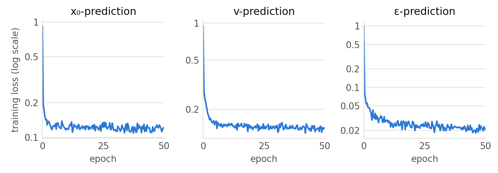
  <figcaption>Training loss for x₀-, v- and ε-prediction, log scale. Each panel has its own y-axis because the values are not comparable: each curve measures error on a different target.</figcaption>
</figure>

<figure>
  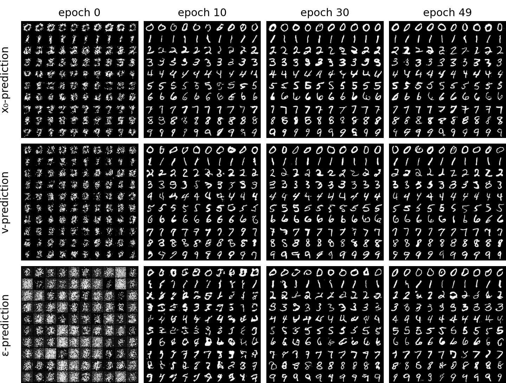
  <figcaption>Samples during training. After the first epoch, ε-prediction still produces almost pure noise, while x₀- and v-prediction already show blurry outlines of digits.</figcaption>
</figure>

### Sampling: 1000 small steps back

To generate, start from pure noise $x_T$ and walk back one step at a time. At each step the network gives an estimate $\hat x_0$, and the true posterior $q(x_{t-1} \mid x_t, x_0)$ is a Gaussian with closed-form mean and variance. So we plug in $\hat x_0$ and sample:

$$
x_{t-1} = \underbrace{\frac{\sqrt{\bar\alpha_{t-1}}\,\beta_t}{1-\bar\alpha_t}}_{\text{coef}_1}\,\hat x_0 + \underbrace{\frac{\sqrt{1-\beta_t}\,(1-\bar\alpha_{t-1})}{1-\bar\alpha_t}}_{\text{coef}_2}\,x_t + \sigma_t z, \qquad \sigma_t^2 = \frac{1-\bar\alpha_{t-1}}{1-\bar\alpha_t}\,\beta_t.
$$

```python
@torch.no_grad()
def p_sample(self, model, xt, t, cond, cfg_scale=1.0):
    # any target (eps / x0 / v) -> x0, clipped to [-1, 1]
    x0, _ = self._pred(model, xt, t, cond, cfg_scale)
    if t[0] == 0:
        return x0
    coef1 = self._extract(self.posterior_coef1, t, xt.shape)
    coef2 = self._extract(self.posterior_coef2, t, xt.shape)
    mean = coef1 * x0 + coef2 * xt
    var = self._extract(self.posterior_var, t, xt.shape)
    return mean + var.sqrt() * torch.randn_like(xt)
```

Because every target is converted to $\hat x_0$ first (and clipped to the valid pixel range), one sampler serves all three models. Here they are with the full 1000 steps:

<figure>
  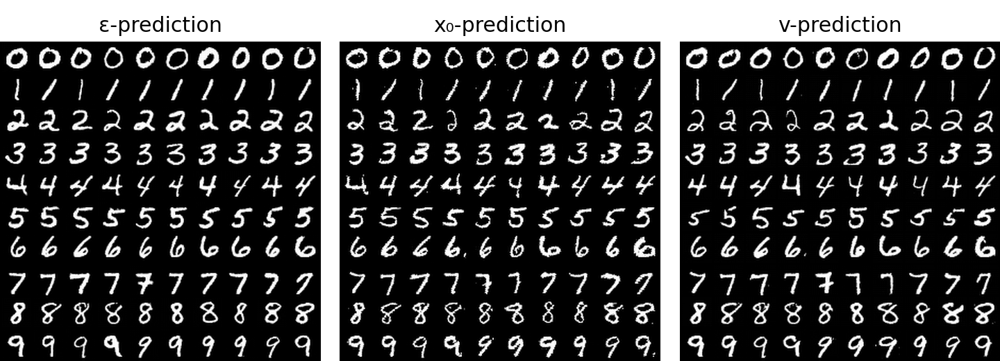
  <figcaption>1000-step DDPM sampling, guidance scale 3. All three work, but they are not identical. ε-prediction gives the cleanest strokes, while x₀-prediction leaves speckles around the digits and v-prediction sits in between.</figcaption>
</figure>

The real problem with DDPM is the cost: **1000 network calls per sample**. Everything that follows is about cutting that number down.

## Part 2 — 1000 → 5 Steps Without Retraining: Fast Samplers

Nothing in the DDPM *training* objective says you have to sample with 1000 steps. The network has learned to estimate $x_0$ from $x_t$ at any noise level. How we walk from noise to data is a separate decision, and we can change it after training. This part keeps the three models from Part 1 exactly as they are and only swaps the sampler.

### DDIM: denoise, then re-noise to a lower level

DDIM ([Song et al., 2020](https://arxiv.org/abs/2010.02502)) makes the observation explicit. At time $t$, use the network to get $\hat x_0$ and the noise it implies, $\hat\epsilon$. Then jump straight to any earlier time $s < t$ by putting them back together with the coefficients of time $s$:

$$
x_s = \sqrt{\bar\alpha_s}\,\hat x_0 + \sqrt{1-\bar\alpha_s}\,\hat\epsilon, \qquad \hat\epsilon = \frac{x_t - \sqrt{\bar\alpha_t}\,\hat x_0}{\sqrt{1-\bar\alpha_t}}.
$$

In words: denoise all the way, then add back the *same* noise, but less of it. No fresh randomness is injected, so sampling becomes a deterministic map from the initial noise to an image. That is why every figure in this post can use the same initial noise and be compared cell by cell. (DDIM also has a parameter $\eta$ that adds noise back in; $\eta = 1$ recovers DDPM-like sampling. I use $\eta = 0$ throughout.) Under the hood this is the Euler method applied to the *probability-flow ODE*, the deterministic ODE whose solutions have the same marginals as the diffusion process.

<figure>
  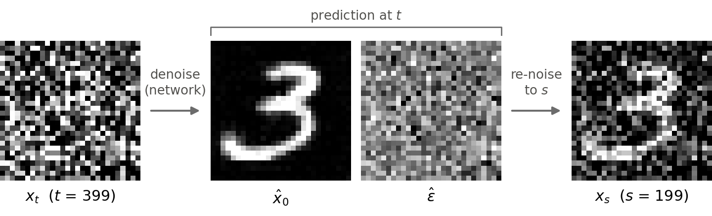
  <figcaption>One real DDIM step, 5-step trailing grid. The network turns $x_t$ into $\hat x_0$ and the noise it implies; the step then recombines them with the coefficients of the lower noise level $s$.</figcaption>
</figure>

The whole step is two lines, and it turns out to be the only building block the fancier samplers need:

```python
@staticmethod
def _ddim_step(x, x0, abar_t, abar_s):
    """Given x0, step deterministically from t to s (eta = 0)."""
    eps = (x - abar_t.sqrt() * x0) / (1 - abar_t).sqrt()
    return abar_s.sqrt() * x0 + (1 - abar_s).sqrt() * eps
```

### Higher-order solvers are "a better x₀, then a DDIM step"

DDIM assumes $\hat x_0$ stays constant over the whole step from $t$ to $s$. That is a first-order approximation, and it is accurate only when the steps are small. DPM-Solver ([Lu et al., 2022](https://arxiv.org/abs/2206.00927)) showed that if you measure time in half log-SNR,

$$
\lambda_t = \log\frac{\sqrt{\bar\alpha_t}}{\sqrt{1-\bar\alpha_t}},
$$

the probability-flow ODE has an exact solution in which the only unknown is an integral of $\hat x_0$ (or $\hat\epsilon$) over $\lambda$. Better solvers approximate that integral better. Implemented this way, each one reduces to "choose an effective $\hat x_0$ for this step, then call `_ddim_step`":

| Sampler | Network calls per step | The $\hat x_0$ it plugs into the DDIM step |
|---|:---:|---|
| DDIM | 1 | the current estimate $\hat x_0^{(i)}$ |
| DPM-Solver++(2M) ([Lu et al., 2022b](https://arxiv.org/abs/2211.01095)) | 1 | extrapolated from the current and previous estimates |
| UniPC ([Zhao et al., 2023](https://arxiv.org/abs/2302.04867)) | 1 | same predictor, plus a corrector that reuses the next step's evaluation |
| DPM-Solver-2 ([Lu et al., 2022](https://arxiv.org/abs/2206.00927)) | 2 | the estimate at the midpoint (in $\lambda$) of the step |

**DPM-Solver++(2M)** keeps the previous step's $\hat x_0$ and extrapolates linearly in $\lambda$, which costs nothing extra:

```python
for i, t in enumerate(ts):
    x0, _ = self._pred(model, x, t, cond, cfg_scale)
    if x0_prev is None or i == steps - 1:  # first or last step: 1st order
        x0_eff = x0
    else:
        # r = previous step size / this step size, in lambda
        r = (lams[i] - lams[i - 1]) / (lams[i + 1] - lams[i])
        x0_eff = x0 + (x0 - x0_prev) / (2 * r)
    x = self._ddim_step(x, x0_eff, abars[i], abars[i + 1])
    x0_prev = x0
```

**UniPC** uses the same predictor, then notices that the network has to be evaluated at the new point anyway, for the next step. So it uses that evaluation immediately as a corrector: it redoes the current step with the average of the $\hat x_0$ at both ends (a trapezoidal rule), and hands the same evaluation on to the next step. The correction is free. My version is a simplified, second-order UniC.

**DPM-Solver-2** is the classic single-step midpoint method: take a trial step to the midpoint in $\lambda$, evaluate the network there, then redo the full step with the midpoint estimate. It is more accurate per step but costs two network calls per step.

### Results

<figure>
  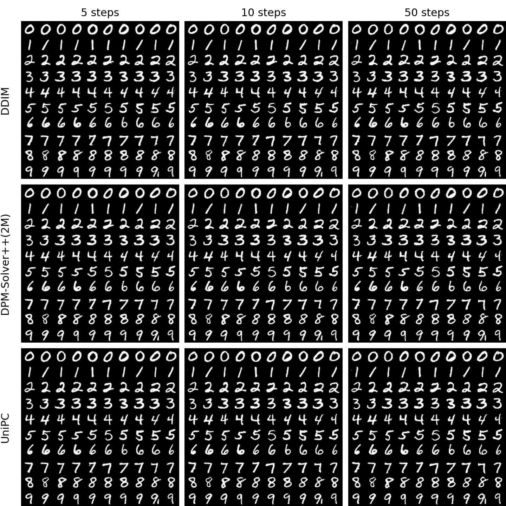
  <figcaption>Comparison of samplers on the ε-prediction model, guidance scale 3, same initial noise. Rows: sampler. Columns: number of steps (= network calls).</figcaption>
</figure>

Going from 1000 to 5 network calls, a **200× speed-up with no retraining**, costs almost nothing visible here. The honest observation is that on MNIST the three samplers are nearly indistinguishable even at 5 steps. Digits are simple, the guided trajectories are fairly straight, and first-order DDIM is already close to converged. The advantage of the higher-order solvers reported in the papers shows up on harder data and at very low step counts. Where things *do* change on MNIST is below 5 steps, and that is where both pitfalls of this part live. DPM-Solver-2 is not in that figure because it spends two calls per step, so comparing it by step count would be unfair.

<div class="callout">

**Pitfall: 2 steps ≈ 1 step**

My first DDIM implementation used the obvious timestep grid, `torch.linspace(999, 0, steps)`. With `steps = 2` that is $t = [999, 0]$. The first call jumps from pure noise to $t = 0$, where $\bar\alpha_0 = 0.9999$, so the image is already finished. The second call, at $t = 0$, has nothing left to do. Half of the budget is wasted, and "2 steps" gives the same image as 1 step.

The fix is the *trailing* grid from [Lin et al., 2023](https://arxiv.org/abs/2305.08891): split $[0, 999]$ into `steps` equal intervals, call the network only at the noisy end of each, and let the last step land directly on the clean image.

```python
# steps=2 -> [999, 499]
ts = torch.linspace(self.T - 1, 0, steps + 1)[:-1].long()
```

<figure>
  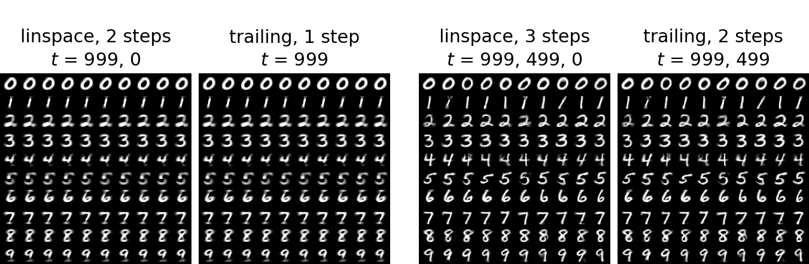
  <figcaption>v-prediction, guidance scale 3, DDIM, same initial noise. Each pair compares the two grids: the <code>linspace</code> grid with 2 steps produces the same images as the trailing grid with 1 step, and <code>linspace</code> with 3 steps matches trailing with 2. The final call at $t = 0$ does nothing.</figcaption>
</figure>

</div>

A side effect worth knowing: with the trailing grid, **DPM-Solver++(2M) and UniPC are exactly identical to DDIM at 1 and 2 steps**. The first step has no previous estimate to extrapolate from, and the last step falls back to first order, so with two steps there is no step left where the higher-order correction applies.

<div class="callout">

**Pitfall: ε-prediction cannot take a single step**

At 1 step, the three models from Part 1 behave completely differently:

<figure>
  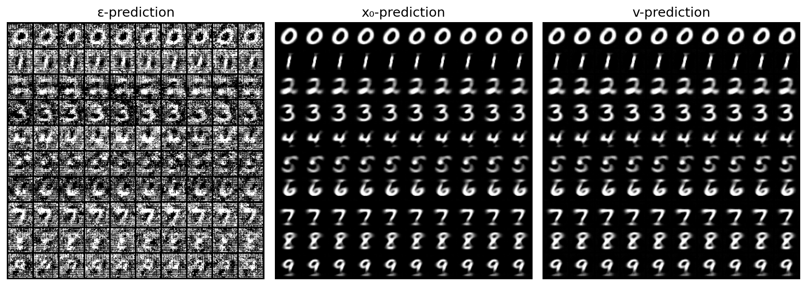
  <figcaption>1-step DDIM (one network call at $t = 999$), guidance scale 3.</figcaption>
</figure>

ε-prediction produces noise with a faint digit behind it, while x₀- and v-prediction give blurry but recognizable digits. A likely reason is the conversion to an image:

$$
\hat x_0 = \frac{x_t - \sqrt{1-\bar\alpha_t}\,\hat\epsilon}{\sqrt{\bar\alpha_t}}, \qquad \sqrt{\bar\alpha_{999}} \approx 0.0064,
$$

so at $t = 999$ any error in $\hat\epsilon$ is amplified about **157×**. With 1000 small steps this never matters, and x₀- and v-prediction avoid the division altogether.

</div>

The **blur** of x₀- and v-prediction is not a bug either. From pure noise, the input says nothing about which particular "3" to draw, and the MSE-optimal answer is the *average* of all 3s, which is a blur. One network call trained with a regression loss can only give you a mean.

This is the real limit of training-free samplers. They make the ODE solve cheaper, but they cannot change what the network was trained to predict. To get a sharp sample in one step, the model has to be trained for it, which is what Part 4 is about. Before that, Part 3 changes the training itself to make the paths from noise to data straighter and easier to integrate.

## Part 3 — Straight Lines: Rectified Flow

Part 2 changed only the sampler. This part changes the training: the forward process, the target and the time variable. The result, Rectified Flow ([Liu et al., 2022](https://arxiv.org/abs/2209.03003); [Lipman et al., 2022](https://arxiv.org/abs/2210.02747)), is simpler than DDPM and needs fewer steps. It is also the coordinate system that every method in Part 4 is built on.

### A simpler forward process

Drop the noise schedule entirely. Let time run continuously from $t = 0$ (data) to $t = 1$ (noise) and interpolate in a straight line:

$$
x_t = (1 - t)\,x_0 + t\,\epsilon, \qquad t \in [0, 1].
$$

Along this line the velocity is constant, and it is what the network learns to predict:

$$
v = \frac{dx_t}{dt} = \epsilon - x_0.
$$

<figure>
<div class="eq-figure">
  <div>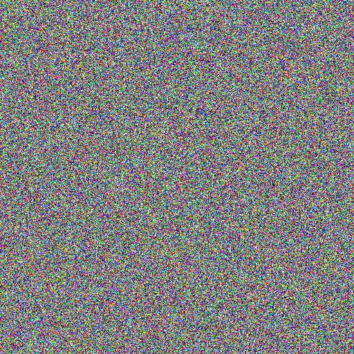<span>$\epsilon$</span></div>
  <div class="op">$-$</div>
  <div><span>$x_0$</span></div>
  <div class="op">$=$</div>
  <div>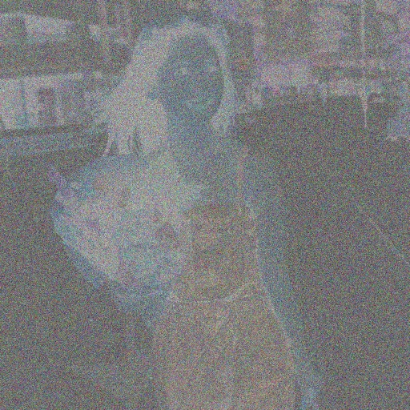<span>$v$</span></div>
</div>
<figcaption>The velocity target. The displayed $v$ is min-max rescaled to the pixel range.</figcaption>
</figure>

This is still a Gaussian noising process, just with coefficients $(1 - t, t)$ instead of $(\sqrt{\bar\alpha_t}, \sqrt{1 - \bar\alpha_t})$. Given $x_t$ and $\hat v$, both other quantities are one line away:

$$
\hat x_0 = x_t - t\,\hat v, \qquad \hat\epsilon = x_t + (1 - t)\,\hat v.
$$

Keep the first one in mind: $\hat x_0 = x_t - t\,\hat v$ appears in every method of Part 4.

### Training in five lines

```python
def loss(self, model, x0, cond):
    t = self.sample_t(x0.shape[0], x0.device)
    x1 = torch.randn_like(x0)  # noise
    tb = t.view(-1, 1, 1, 1)
    xt = (1 - tb) * x0 + tb * x1
    # t is scaled to [0, 1000] for the time embedding
    v_pred = model(xt, t * self.t_scale, cond)
    return F.mse_loss(v_pred, x1 - x0)
```

### Sampling: just integrate the velocity

Generation solves the ODE $dx/dt = v(x, t)$ backwards, from $t = 1$ to $t = 0$. With Euler's method this is a three-line loop:

```python
x = torch.randn(shape)
ts = torch.linspace(1.0, 0.0, steps + 1)
for t, t_next in zip(ts[:-1], ts[1:]):
    x = x + (t_next - t) * v(x, t)   # dt < 0: move against v, towards the data
```

Heun's method ([Karras et al., 2022](https://arxiv.org/abs/2206.00364)) adds a correction: take an Euler step, evaluate the velocity at the end point, and redo the step with the average of the two velocities. That costs 2 network calls per step (1 for the last step), like DPM-Solver-2.

<figure>
  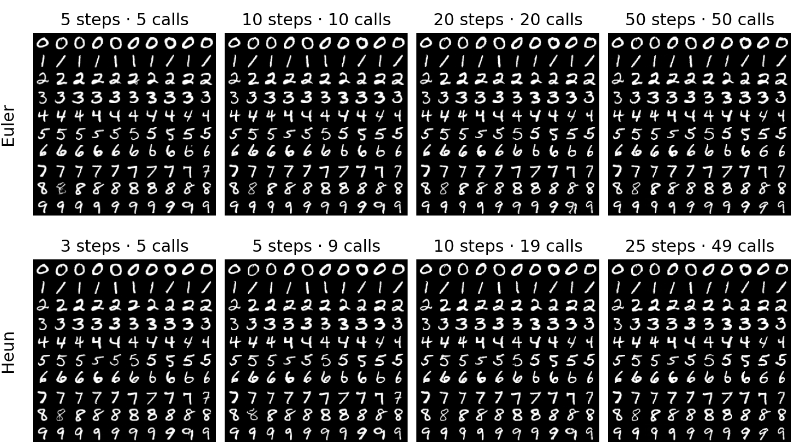
  <figcaption>Euler (top) vs Heun (bottom), guidance scale 3, same initial noise, columns roughly matched by network calls. Heun takes two calls per step except the last.</figcaption>
</figure>

As with the DDPM solvers, the second-order method buys nothing visible here. Euler with 5 steps is already about as good as anything with 50.

### Classifier-free guidance

All models so far were trained with the class label dropped 10% of the time (replaced by a "null" label, index 10). The network therefore learns both a conditional velocity $v(x, t \mid y)$ and an unconditional one $v(x, t \mid \varnothing)$. Classifier-free guidance ([Ho & Salimans, 2022](https://arxiv.org/abs/2207.12598)) extrapolates away from the unconditional prediction at sampling time:

$$
\tilde v = v(x, t \mid \varnothing) + w\,\big(v(x, t \mid y) - v(x, t \mid \varnothing)\big),
$$

with $w = 1$ meaning no guidance. Both branches go through the network as a single batch of twice the size:

```python
out = model(torch.cat([x, x]), torch.cat([t, t]), torch.cat([cond, null_cond]))
v_c, v_u = out.chunk(2)
v = v_u + cfg_scale * (v_c - v_u)
```

<figure>
  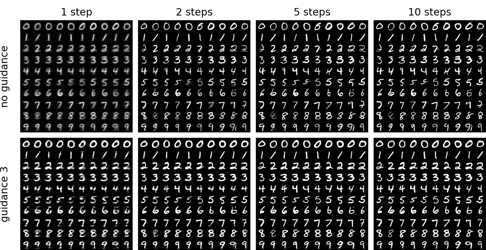
  <figcaption>Top: no guidance ($w = 1$). Bottom: $w = 3$. Euler sampler, same initial noise.</figcaption>
</figure>

Without guidance the samples are more varied but less reliable: thin strokes, a 2 that looks like an R, an 8 that falls apart. With $w = 3$ the digits are thicker, cleaner and more uniform. That is the usual trade of diversity for fidelity. Guidance also doubles the cost of every step, a cost the distillation methods in Part 4 will remove by baking the guided teacher into the student.

### DDPM vs Rectified Flow at few steps

The real payoff shows up when the step budget is tiny. Here are DDPM (with v-prediction, which handles big steps far better than ε-prediction) and Rectified Flow side by side at 1–5 network calls:

<figure>
  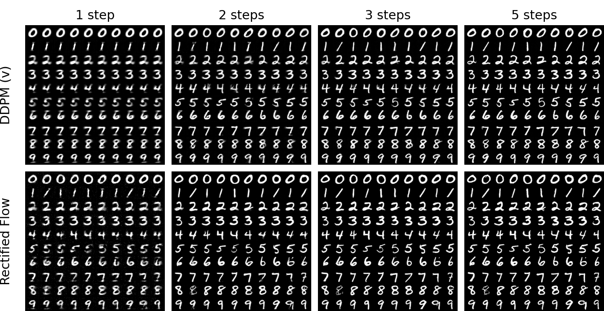
  <figcaption>Guidance scale 3, same initial noise. Top: DDPM, v-prediction, DDIM. Bottom: Rectified Flow, Euler. The two models also differ in how they sample $t$ during training, so this is not a perfectly controlled comparison.</figcaption>
</figure>

At 5 steps the two are indistinguishable. At 2 and 3 steps Rectified Flow is visibly ahead: its digits are already sharp, while DDPM still shows ghosting and soft edges.

The bigger lesson of Parts 2 and 3 is where the limit lies. Better solvers and straighter paths get us from 1000 calls to about 3. To get to **one**, the model has to be trained to take one big step, which is what Part 4 does.

## Part 4 — The Final Leap: 1-step Generators

Parts 2 and 3 ended at the same wall. A network trained by regression to predict $x_0$ (or $v$) from pure noise can only output the *average* image, because the noise says nothing about which sample to draw. To get a sharp sample from one network call, the training objective itself has to change. The three families in this part change it in three different ways:

<div class="method-cards">
<div class="method-card">
<div class="mc-fig"><svg viewBox="0 0 200 120" role="img" aria-label="Points along one trajectory all map to the same endpoint"><defs><marker id="mc-a" viewBox="0 0 10 10" refX="8" refY="5" markerWidth="6" markerHeight="6" orient="auto-start-reverse"><path d="M0,0 L10,5 L0,10 z" style="fill:#e8590c"/></marker><marker id="mc-g" viewBox="0 0 10 10" refX="8" refY="5" markerWidth="6" markerHeight="6" orient="auto-start-reverse"><path d="M0,0 L10,5 L0,10 z" style="fill:var(--secondary)"/></marker></defs><path d="M20,100 C22,40 110,22 182,22" style="fill:none;stroke:var(--secondary);stroke-width:1.5"/><line x1="49.3" y1="51.4" x2="24" y2="97" style="stroke:#e8590c;stroke-width:1.4" marker-end="url(#mc-a)"/><line x1="94.4" y1="32.2" x2="24" y2="97" style="stroke:#e8590c;stroke-width:1.4" marker-end="url(#mc-a)"/><line x1="155.6" y1="22.8" x2="24" y2="97" style="stroke:#e8590c;stroke-width:1.4" marker-end="url(#mc-a)"/><circle cx="49.3" cy="51.4" r="3.2" style="fill:var(--primary)"/><circle cx="94.4" cy="32.2" r="3.2" style="fill:var(--primary)"/><circle cx="155.6" cy="22.8" r="3.2" style="fill:var(--primary)"/><circle cx="20" cy="100" r="4.5" style="fill:#e8590c"/><text x="14" y="116" text-anchor="start" style="fill:var(--secondary);font-size:12px">data</text><text x="186" y="14" text-anchor="end" style="fill:var(--secondary);font-size:12px">noise</text></svg></div>
<div class="mc-name">Consistency Models</div>
<p>Every point on a trajectory should map to the <em>same endpoint</em>, so one call from noise lands on the image.</p>
</div>
<div class="method-card">
<div class="mc-fig"><svg viewBox="0 0 200 120" role="img" aria-label="Instantaneous velocity is a tangent; the average velocity is the straight chord to the end of the interval"><defs><marker id="mc-a2" viewBox="0 0 10 10" refX="8" refY="5" markerWidth="6" markerHeight="6" orient="auto-start-reverse"><path d="M0,0 L10,5 L0,10 z" style="fill:#e8590c"/></marker><marker id="mc-g2" viewBox="0 0 10 10" refX="8" refY="5" markerWidth="6" markerHeight="6" orient="auto-start-reverse"><path d="M0,0 L10,5 L0,10 z" style="fill:var(--secondary)"/></marker></defs><path d="M20,100 C22,40 110,22 182,22" style="fill:none;stroke:var(--secondary);stroke-width:1.2;opacity:0.6"/><line x1="98.6" y1="31.1" x2="51.9" y2="42.2" style="stroke:var(--secondary);stroke-width:1.5;stroke-dasharray:3 2" marker-end="url(#mc-g2)"/><line x1="98.6" y1="31.1" x2="25.1" y2="83.4" style="stroke:#e8590c;stroke-width:1.8" marker-end="url(#mc-a2)"/><circle cx="98.6" cy="31.1" r="3.2" style="fill:var(--primary)"/><circle cx="22.1" cy="86.4" r="3.2" style="fill:var(--primary)"/><text x="102.6" y="22.1" text-anchor="start" style="fill:var(--secondary);font-size:12px;font-style:italic">zₜ</text><text x="32.1" y="92.4" text-anchor="start" style="fill:var(--secondary);font-size:12px;font-style:italic">zᵣ</text><text x="45.9" y="36.2" text-anchor="end" style="fill:var(--secondary);font-size:12px;font-style:italic">v</text><text x="72.35" y="70.75" text-anchor="middle" style="fill:#e8590c;font-size:12px;font-style:italic">u</text></svg></div>
<div class="mc-name">MeanFlow</div>
<p>Learn the <em>average</em> velocity over an interval instead of the instantaneous one, so one step is exact.</p>
</div>
<div class="method-card">
<div class="mc-fig"><svg viewBox="0 0 200 120" role="img" aria-label="The generator distribution is pushed towards the teacher distribution"><defs><marker id="mc-a" viewBox="0 0 10 10" refX="8" refY="5" markerWidth="6" markerHeight="6" orient="auto-start-reverse"><path d="M0,0 L10,5 L0,10 z" style="fill:#e8590c"/></marker><marker id="mc-g" viewBox="0 0 10 10" refX="8" refY="5" markerWidth="6" markerHeight="6" orient="auto-start-reverse"><path d="M0,0 L10,5 L0,10 z" style="fill:var(--secondary)"/></marker></defs>
<line x1="8" y1="100" x2="192" y2="100" style="stroke:var(--tertiary);stroke-width:1"/>
<path d="M10,100 C35,100 40,48 60,48 C80,48 85,100 110,100" style="fill:none;stroke:var(--secondary);stroke-width:1.5;stroke-dasharray:4 3"/>
<path d="M90,100 C115,100 120,32 140,32 C160,32 165,100 190,100" style="fill:none;stroke:var(--primary);stroke-width:1.8"/>
<line x1="70" y1="66" x2="122" y2="58" style="stroke:#e8590c;stroke-width:1.8" marker-end="url(#mc-a)"/>
<text x="60" y="38" text-anchor="middle" style="fill:var(--secondary);font-size:12px">generator</text><text x="140" y="22" text-anchor="middle" style="fill:var(--secondary);font-size:12px">teacher</text></svg></div>
<div class="mc-name">DMD2</div>
<p>Forget trajectories: push the one-step generator's output <em>distribution</em> towards the teacher's.</p>
</div>
</div>

### Consistency Models: jump straight to the end of the trajectory

**The idea.** The sampling ODE from Part 3 defines a trajectory from every noise sample to an image. Every point $x_t$ on one trajectory should therefore map to the *same* endpoint $x_0$. A consistency model ([Song et al., 2023](https://arxiv.org/abs/2303.01469)) learns that map, $f(x_t, t) \mapsto x_0$, directly. If it succeeds, one call at $t = 1$ produces an image.

**The parameterization.** The map must satisfy $f(x, 0) = x$, since a clean image is its own endpoint. The original paper enforces this with EDM's $c_\text{skip}$ and $c_\text{out}$ coefficients. In Rectified Flow coordinates it comes for free: keep the network predicting a velocity and define

$$
f_\theta(x_t, t) = x_t - t\, v_\theta(x_t, t),
$$

which equals $x$ exactly at $t = 0$. It is the same $\hat x_0 = x_t - t\,\hat v$ from Part 3, so a Rectified Flow model is already a (bad) consistency model, and a good initialization for one.

**The loss.** Split $[0, 1]$ into $N$ intervals. Take a point $x_t$ and its neighbour $x_{t'}$ one interval closer to the data on the *same* trajectory. Ask that both map to the same place, with the target computed by the current model under stop-gradient:

$$
\mathcal{L} = d\big(f_\theta(x_t, t),\ \operatorname{sg}[f_\theta(x_{t'}, t')]\big).
$$

At $t' = 0$ the target is the real image, and consistency propagates upward from there. The only question is how to get $x_{t'}$, and the two answers give the two variants.

#### Consistency Training (CT): no teacher

CT builds $x_{t'}$ from the same $(x_0, \epsilon)$ pair as $x_t$, which is one Euler step along the *conditional* velocity $\epsilon - x_0$. No pretrained model is needed. I followed the recipe of improved CT ([Song & Dhariwal, 2023](https://arxiv.org/abs/2310.14189)): the target is the current model under stop-gradient (not an EMA copy), the distance is a pseudo-Huber loss, the loss is weighted by $1/\Delta t$, and $N$ doubles from 10 to 1280 over training so that early steps are large and stable and later ones are small and accurate.

```python
def loss_ct(self, model, x0, cond, it):
    N = self.num_steps(it)                 # 10 -> 1280, doubling
    B = x0.shape[0]
    t = torch.sigmoid(torch.randn(B) * 2.0 - 1.1)  # iCT lognormal
    i = torch.ceil(t * N).clamp(1, N)
    t, tp = i / N, (i - 1) / N             # snap to the grid
    # (t and tp are broadcast over pixels below)
    x1 = torch.randn_like(x0)
    xt  = (1 - t) * x0 + t * x1            # same (x0, x1) pair
    xtp = (1 - tp) * x0 + tp * x1
    pred = self.f(model, xt, t, cond)
    with torch.no_grad():
        target = self.f(model, xtp, tp, cond)
    return (N * self._pseudo_huber(pred, target)).mean()
```

#### Consistency Distillation (CD): use the Rectified Flow model as teacher

CD changes one thing: $x_{t'}$ comes from the Part 3 model taking a single Heun step from $x_t$, so the student learns the teacher's *actual* trajectories. The teacher runs with guidance $w = 3$, so the guidance gets baked into the student, which then needs no CFG (and no second forward pass) at sampling time. The student starts as a copy of the teacher, and $N = 20$ is fixed.

```python
with torch.no_grad():                       # one Heun step of the guided teacher
    dt = tp - t
    v1 = self._teacher_v(teacher, xt, t, cond, cfg_scale)
    v2 = self._teacher_v(teacher, xt + dt * v1, tp, cond, cfg_scale)
    xtp = xt + dt * 0.5 * (v1 + v2)
    target = self.f(model, xtp, tp, cond)
```

<figure>
  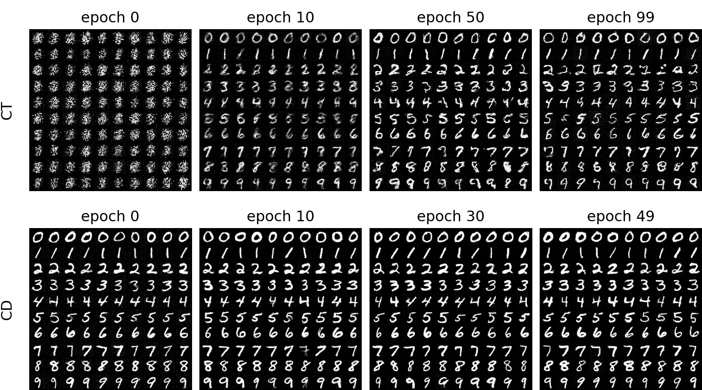
  <figcaption>1-step samples during training. Top: CT from scratch, 100 epochs. Bottom: CD from the Rectified Flow teacher, 50 epochs.</figcaption>
</figure>

The difference is stark. CD produces sharp, guided digits after the very first epoch: it starts from the teacher and only has to learn to skip to the end of trajectories the teacher already knows. CT has to discover the trajectories from data alone. It improves steadily but even after 100 epochs its digits are thinner and rougher, with broken strokes. Part of the gap is guidance, which CT cannot have. CFG mixes *velocities*, which are derivatives, but a consistency model outputs the *endpoint* of a trajectory, an integral along the path. The endpoint of the guided ODE is not a mix of the conditional and unconditional endpoints, and getting it requires evaluating the guided velocity along the way, which is exactly what the teacher does in CD.


**More steps.** A consistency model can also sample in several steps: predict $\hat x_0$, add fresh noise back to a smaller $t$, and predict again. Unlike the ODE samplers, this injects new randomness at every step.

```python
@torch.no_grad()
def sample(self, model, shape, cond, ts=(1.0,)):  # (1.0, 0.5) for 2 steps
    x = torch.randn(shape)
    for k, t in enumerate(ts):
        x0 = self.f(model, x, torch.full((shape[0],), t), cond)
        if k + 1 < len(ts):  # re-noise with fresh noise to the next t
            x = (1 - ts[k + 1]) * x0 + ts[k + 1] * torch.randn_like(x0)
    return x0
```

<div class="callout">

**Pitfall: CT collapses when $N$ doubles**

My first CT run sampled $t$ with Rectified Flow's logit-normal(0, 1). Around epoch 40, right after $N$ switched from 40 to 80, the 1-step samples turned into pure noise. The run recovered over the next ten epochs, and the collapse reproduced in repeated runs.

<figure>
  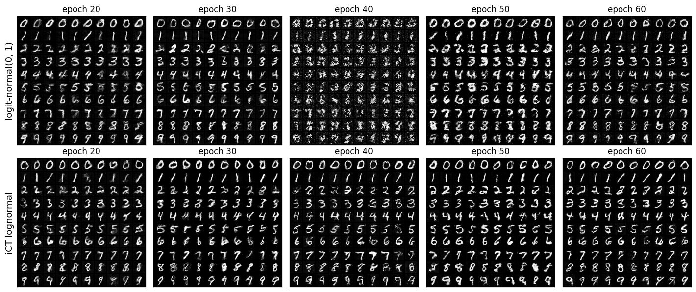
  <figcaption>1-step CT samples around the collapse. Top: logit-normal(0, 1). Bottom: the lognormal distribution from iCT. Everything else is identical.</figcaption>
</figure>

The likely cause is how rarely the logit-normal visits high noise: only **0.16%** of its samples land at $t \ge 0.95$. That region is exactly where 1-step generation starts, and it sits at the far end of the consistency chain that propagates up from the data. When $N$ doubles, every interval is suddenly half as long and the targets there shift, with almost no training signal to re-anchor them. iCT samples $\log\sigma \sim \mathcal{N}(-1.1, 2^2)$ with $\sigma = t/(1-t)$, a much wider distribution that puts **2.2%** of the samples at $t \ge 0.95$, about 14× more. With that change, the run did not collapse.

**Lesson:** the time distribution decides which parts of the trajectory the model ever learns. The logit-normal that is ideal for Rectified Flow is a poor fit for CT.

</div>

### MeanFlow: learn the average velocity

**The idea.** A single Euler step from $t$ to $r$ with Rectified Flow's velocity is wrong because the velocity changes along the path. But there is *some* velocity that makes one step exact, the **average** velocity over the interval:

$$
u(z_t, r, t) = \frac{1}{t - r} \int_r^t v(z_\tau, \tau)\, d\tau, \qquad z_r = z_t - (t - r)\, u(z_t, r, t).
$$

MeanFlow ([Geng et al., 2025](https://arxiv.org/abs/2505.13447)) trains a network to predict $u$. With $t = 1$ and $r = 0$, one call goes from noise to image, and nothing about it is approximate if $u$ is learned well. When $r = t$, $u$ is just the instantaneous velocity, so ordinary flow matching is a special case.

**The trick.** The integral cannot be computed during training. Multiplying the definition by $(t - r)$ and differentiating with respect to $t$ gives an identity that involves only quantities at time $t$:

$$
u(z_t, r, t) = v(z_t, t) - (t - r)\,\frac{d}{dt} u(z_t, r, t), \qquad \frac{d}{dt}u = v\,\partial_z u + \partial_t u.
$$

So the training target is $u_\text{tgt} = v - (t - r)\,\operatorname{sg}\big[\tfrac{d}{dt}u\big]$, with $v = \epsilon - x_0$ as in Rectified Flow. The total derivative $\tfrac{d}{dt}u$ is a Jacobian-vector product of the network with tangent $(v, 0, 1)$ in $(z, r, t)$, and PyTorch computes it in one call:

```python
with torch.no_grad(), sdpa_kernel(SDPBackend.MATH):
    _, dudt = torch.func.jvp(
        lambda z, r, t: self.u(model, z, r, t, cond),
        (z, r, t),
        (v, torch.zeros_like(r), torch.ones_like(t)),
    )
u_tgt = v - (t - r).view(-1, 1, 1, 1) * dudt
u = self.u(model, z, r, t, cond)   # normal forward; gradients flow here
err = ((u - u_tgt) ** 2).flatten(1).sum(1)
```

The DiT gets one extra input: an embedding of the interval length $h = t - r$, added to the time embedding. Following the paper, $(t, r)$ come from two logit-normal(−0.4, 1) samples, and 75% of the batch uses $r = t$ (plain flow matching).

MeanFlow can also bake in guidance during training, by replacing the target velocity with a guided one built from the model's own unconditional prediction; ω is that guidance scale.


<figure>
  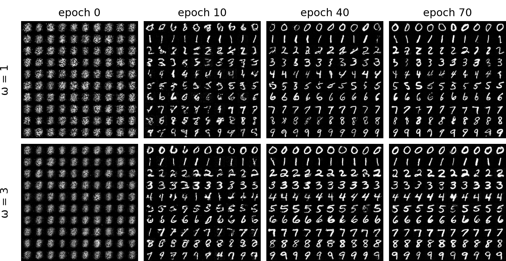
  <figcaption>1-step MeanFlow samples during training, from scratch, 100 epochs. Top: no guidance ($\omega = 1$). Bottom: $\omega = 3$.</figcaption>
</figure>

From scratch and without a teacher, MeanFlow reaches sharp 1-step samples and ends up much cleaner than CT. Training-time guidance has the same effect as CFG had on Rectified Flow: $\omega = 3$ gives thicker, more uniform, more reliable digits, while $\omega = 1$ is more varied and makes more mistakes.

<div class="callout">

**Pitfall: `t × 1000` silently breaks MeanFlow**

My first MeanFlow runs reused the Rectified Flow code path, which multiplies $t$ by 1000 before the sinusoidal time embedding (Part 3). The MSE kept *rising*, and the 1-step samples were blurry and often the wrong class.

The cause is the derivative in the target. Rectified Flow never differentiates the network with respect to time, so the scale of $t$ only affects which frequencies the embedding uses. MeanFlow's target contains $\partial u/\partial t$, and scaling $t$ by 1000 scales that derivative by up to 1000 through the high-frequency components of the embedding. I measured $\partial u / \partial h$ at **14–43**, while $|v|$ is about **1.4**. The target was dominated by the derivative term, and the model chased it instead of the data.

The fix is one line: feed $t$ and $t - r$ in $[0, 1]$, as the official implementation does. Training then converged normally.

</div>

<div class="callout">

**Pitfall: the JVP costs over 4× the memory**

Two separate problems made the first working version need about 53GB at batch size 256:

1. PyTorch's default fused attention kernels do not support forward-mode autodiff, so the JVP must run with `sdpa_kernel(SDPBackend.MATH)`.
2. Computing the JVP inside autograd also stores the graph of the tangent computation for the backward pass. But the target is stop-gradient anyway, so none of that is needed. Running the JVP under `torch.no_grad()` and getting $u$ from a separate ordinary forward pass (with the fast kernel) brings memory down to about 12GB.

</div>

### DMD2: match distributions, not trajectories

**The idea.** CD and MeanFlow still try to reproduce *trajectories*. Distribution Matching Distillation ([Yin et al., 2023](https://arxiv.org/abs/2311.18828); DMD2, [Yin et al., 2024](https://arxiv.org/abs/2405.14867)) does not care which noise maps to which image. It only asks that the generator's *outputs*, as a distribution, look like the teacher's. Three networks take part, all of them copies of the Rectified Flow model at the start:

- **The teacher** (the "real score"), frozen, run with guidance $w = 3$. Given a noised sample, it says where the *data* distribution would denoise it to.
- **The generator** $G$, a one-step model: $x = z - v_G(z, t{=}1)$, which is one Euler step from pure noise. At initialization this is exactly the blurry 1-step Rectified Flow sample.
- **The fake score**, trained online with flow matching on the generator's outputs. It says where the *generator's* distribution would denoise the same sample to.

<figure>

<figcaption>The DMD2 setup. Each loss is colored by the parameters it updates: orange losses train the generator, blue losses train the fake score and its discriminator head. The teacher is frozen.</figcaption>
</figure>

**The distribution matching gradient.** Take a generated $x$, noise it to a random $t \in [0.02, 0.98]$, and ask both scores for $\hat x_0$. The difference $\hat x_0^\text{fake} - \hat x_0^\text{real}$ points from "what the generator makes" towards "what real data looks like" around that sample; it is the gradient of $\mathrm{KL}(p_\text{fake} \,\|\, p_\text{real})$ with respect to $x$. Implementing it is a two-line trick: a regression loss whose target is the sample moved one step against the gradient.

```python
# distribution matching (DM) loss for the generator; x = G(z), with gradients
with torch.no_grad():
    xt = self._noise(x, t)
    x0_real = self._x0(teacher, xt, t, cond, self.cfg_scale)
    x0_fake = self._x0(fake, xt, t, cond)
    w = (x - x0_real).abs().mean(dim=(1, 2, 3), keepdim=True)
    grad = (x0_fake - x0_real) / w     # normalized per sample
loss_dm = 0.5 * F.mse_loss(x, (x - grad).detach())
```

The DM loss updates only the **generator** $G$. Both scores are evaluated under `no_grad`, so the gradient reaches $G$'s weights only through $x = G(z)$; the teacher stays frozen, and the fake score is not touched by this loss.

The fake score is kept up to date with plain flow matching (FM) on the generator's outputs, exactly the Rectified Flow loss from Part 3 with $x$ in place of real data:

```python
# flow matching (FM) loss for the fake score; x is detached
def loss_fake(self, fake, x, cond):
    x = x.detach()
    t = torch.rand(x.shape[0], device=x.device)
    x1 = torch.randn_like(x)
    xt = (1 - t.view(-1, 1, 1, 1)) * x + t.view(-1, 1, 1, 1) * x1
    return F.mse_loss(fake(xt, t * self.t_scale, cond), x1 - x)
```

The FM loss updates only the **fake score**. $x$ is detached, so no gradient flows back into $G$. The two losses alternate, with 5 fake-score updates per generator update (below).

**The GAN losses.** The DM loss only pulls the generator towards the *teacher*, so the generator can never be better than the teacher's view of the data. DMD2 adds a GAN term that compares the generator's outputs with *real images* directly. It is a diffusion GAN: both real and generated images are first noised to a random $t$, and the discriminator works on the noised versions. The discriminator reuses the fake score network as its backbone: a forward hook grabs the token features of its last DiT block, and a small convolutional head turns them into one logit per image. The DiT itself is unchanged.

```python
def _logits(self, fake, head, x, cond):
    t = torch.rand(x.shape[0], device=x.device)
    # the forward hook stores the last-block features in self._feat
    fake(self._noise(x, t), t * self.t_scale, cond)
    return head(self._feat)

# discriminator loss: real images -> real, generator outputs -> fake
def loss_gan_d(self, fake, head, x_real, x_fake, c_real, c_fake):
    l_real = self._logits(fake, head, x_real, c_real)
    l_fake = self._logits(fake, head, x_fake.detach(), c_fake)
    return (F.softplus(-l_real) + F.softplus(l_fake)).mean()

# generator loss (non-saturating): make the discriminator call G(z) real
def loss_gan_g(self, fake, head, x, cond):
    return F.softplus(-self._logits(fake, head, x, cond)).mean()
```

The **discriminator loss** updates the **fake score network and the head** together, with the same optimizer as the FM loss, so the fake network's features learn to tell real from generated. The generated images are detached, so $G$ is not affected. The **generator GAN loss** updates only $G$: its gradient passes through the head and the fake network to reach $x = G(z)$, and the gradients it leaves on the fake network and the head are cleared before their own update.


Two more details from DMD2 complete the recipe:

- **Two time-scale updates (TTUR):** the fake score and head take 5 updates for every generator update. The DM gradient is only meaningful if the fake score actually models the generator's *current* outputs, so it has to keep up with a moving target.
- **No regression loss:** the original DMD also regressed the generator onto precomputed teacher samples (noise–image pairs from the full ODE), which is expensive to build and ties the generator to the teacher. DMD2 drops it, and so does this implementation.

<figure>
  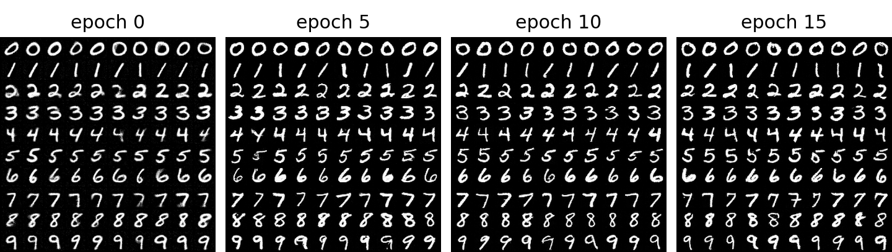
  <figcaption>DMD2 generator, 1 step, during training (20 epochs).</figcaption>
</figure>

At epoch 0 the generator still shows the blur it inherited from the 1-step teacher. By epoch 5 the digits are sharp, thick and guided.

**How do you know it's working?** DMD2's losses are not useful progress bars: the DM loss is a moving target, and the fake score and the discriminator chase a generator that keeps changing. What matters is whether the fake score is good enough for the DM gradient to be trusted, and whether the GAN is balanced. 

I measure the fake score on a fixed **probe batch** (fixed $z$, labels, $t$ and noise), so the numbers are comparable across training. The figure shows metrics I monitor during training.

<figure>
  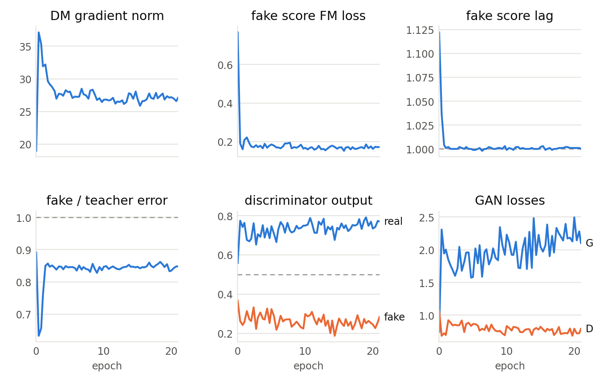
  <figcaption>DMD2 diagnostics over 20 epochs. Dashed lines mark reference values: 1 for the lag and the fake/teacher ratio, 0.5 for the discriminator output at equilibrium.</figcaption>
</figure>

**`fake score lag`** is the fake score's denoising error on the generator's samples right after a generator update, divided by the same error after its 5 catch-up updates. It asks: *does the fake score keep up?* Here it starts slightly above 1, while the generator is still moving fast away from its blurry starting point, and settles at 1 within the first epoch. If it stays clearly above 1, raise the TTUR ratio or lower the generator's learning rate. A lag of 1 alone is ambiguous, since a fake score that is not learning at all also gives 1, so read it together with the next signal.

**`fake/teacher`** is the fake score's denoising error on the generator's samples, divided by the teacher's. It asks: *does the fake score know the generator's distribution better than the teacher does?* Only then is $\hat x_0^\text{fake} - \hat x_0^\text{real}$ a real signal. Here it stays below 1 throughout. It dips early, when the generator's blurry outputs are unlike real data, and then rises slowly as the generator approaches the data, which is convergence: a perfect generator would give exactly 1. A ratio above 1 means the DM gradient is unreliable: raise the TTUR ratio or check the fake score's learning rate.

**`p_real` and `p_fake`** are the discriminator's average probabilities for real and generated images. They ask: *is the GAN balanced?* Here the discriminator is ahead but far from saturated. If `p_real` → 1 and `p_fake` → 0, the discriminator has won: lower the discriminator loss weight. If both stay near 0.5, it is too weak to matter: raise the discriminator loss weight. The GAN losses in the last panel tell the same story; large swings between them mean the game is unstable.

### The showdown

Here is every method with one network call and the same initial noise, the figure from the top of the post:

<figure>
  
  <figcaption>One network call. DDPM (ε, DDIM) and Rectified Flow were not trained for one step. CT has no guidance; CD and DMD2 distill a guided teacher ($w = 3$); MeanFlow uses training-time guidance ($\omega = 3$).</figcaption>
</figure>

And with two calls, for the methods that support multi-step sampling:

<figure>
  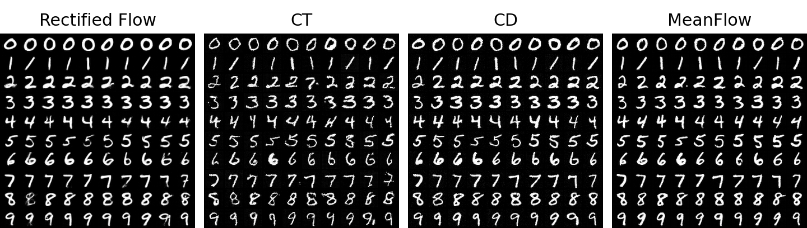
  <figcaption>Two network calls. Rectified Flow uses Euler with CFG (4 forward passes in total); CT and CD re-noise between steps; MeanFlow takes two average-velocity steps.</figcaption>
</figure>

| | Teacher | Calls | Guidance | Training (this repo) | 1-step quality |
|---|---|:---:|---|---|---|
| DDPM (ε), DDIM | — | 1 | CFG (2 passes) | 50 epochs, ~25 min | noise |
| Rectified Flow, Euler | — | 1 | CFG (2 passes) | 50 epochs, ~25 min | blurry average |
| CT | none | 1–2 | none | 100 epochs, ~70 min | recognizable, rough strokes |
| CD | RF, $w = 3$ | 1–2 | distilled | 50 epochs, ~65 min + teacher | sharp |
| MeanFlow, $\omega = 3$ | none | 1–2 | training-time | 100 epochs, ~2 h | sharp |
| DMD2 | RF, $w = 3$ | 1 | distilled | 20 epochs, ~40 min + teacher | sharpest, thickest strokes |

A few things stand out:

- **A teacher makes everything easier.** CD and DMD2 are sharp within an epoch or two. They inherit both the trajectories and the guidance from a model that already works, and only learn to compress it.
- **Without a teacher, MeanFlow is clearly ahead of CT.** Both train from scratch, but MeanFlow's target is exact for any interval, while CT has to propagate consistency up a chain one interval at a time and is sensitive to how it samples $t$. MeanFlow pays for this with a JVP in every step and the longest training time here.
- **More steps help less than you would expect.** CT, CD and MeanFlow all look about the same at 1 and 2 steps. Once a model is trained for one step, the second step is mostly a refinement.
- **The cost moves from sampling to training.** Every 1-step method here takes longer to train than the 1000-step DDPM. That is the trade: pay once at training time, and every sample afterwards costs a single network call.

## Part 5 — LoRA Fine-tuning

LoRA ([Hu et al., 2021](https://arxiv.org/abs/2106.09685)) fine-tunes a large model cheaply by freezing its weights and learning only a small low-rank update next to each layer.

### Fine-tuning on outlined MNIST

I made a synthetic dataset: 100 training images per class, 1000 in total, where each digit is replaced by its outline. The outline is a 3×3 dilation of the digit minus the digit itself, so only a one-pixel ring around each stroke survives.

<figure>
  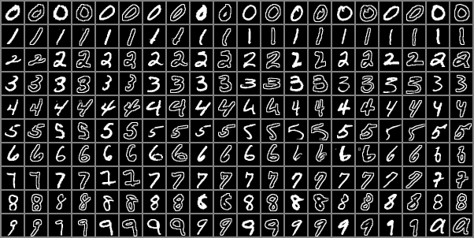
  <figcaption>The fine-tuning data. Each pair is an original digit (left) and its outline (right).</figcaption>
</figure>

The base model is the Rectified Flow model from Part 3, trained on normal MNIST. It has never seen an outlined digit. The goal is to make it draw outlines while keeping what it knows: class conditioning, guidance, and the shapes of the digits.

### LoRA in 30 lines

Concretely, each frozen weight $W$ gets a low-rank update next to it:

$$
y = W x + s \cdot \frac{\alpha}{r}\, B A x, \qquad A \in \mathbb{R}^{r \times d_\text{in}},\ B \in \mathbb{R}^{d_\text{out} \times r}.
$$

$B$ starts at zero, so the model is unchanged at the start of training. $s$ is an extra knob that is not trained: it scales the update at inference time.

```python
class LoRALinear(nn.Module):
    def __init__(self, base, r, alpha):
        super().__init__()
        self.base, self.factor, self.scale = base, alpha / r, 1.0
        self.A = nn.Parameter(torch.empty(r, base.in_features))
        self.B = nn.Parameter(torch.zeros(base.out_features, r))
        nn.init.kaiming_uniform_(self.A, a=math.sqrt(5))

    def forward(self, x):
        lora = x @ self.A.T @ self.B.T
        return self.base(x) + self.scale * self.factor * lora
```

`apply_lora` freezes the model and swaps in `LoRALinear` for the attention (`qkv`, `proj`) and MLP (`fc1`, `fc2`) layers of every DiT block. The adaLN modulation layers, which inject the time and class embeddings, are left alone, as is common practice. Only $A$ and $B$ are trained and saved: the adapter for $r = 4$ is about 0.5MB, against 39MB for the full model.

### Results

<figure>
  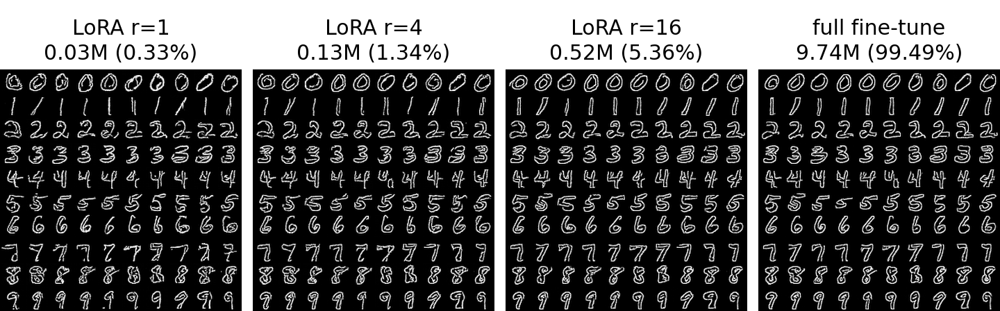
  <figcaption>The four fine-tuned models; each title gives the trainable parameters and their share of the model. 50 Euler steps, guidance scale 3, same initial noise everywhere.</figcaption>
</figure>

Every variant learned the style. Even $r = 1$, with a third of a percent of the parameters, draws outlined digits of the right class. More capacity gives cleaner results: $r = 1$ produces doubled, wobbly contours, while $r = 16$ is hard to tell apart from full fine-tuning.

<figure>
  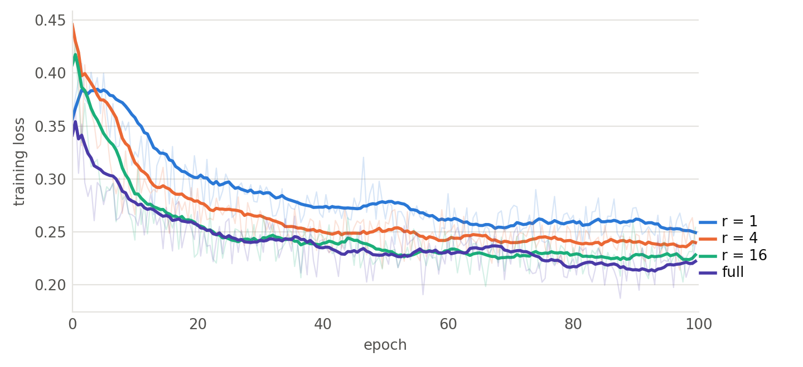
  <figcaption>Training loss; faint lines are the raw loss, bold lines a moving average. Higher rank fits faster and lower; full fine-tuning is lowest.</figcaption>
</figure>

<figure>
  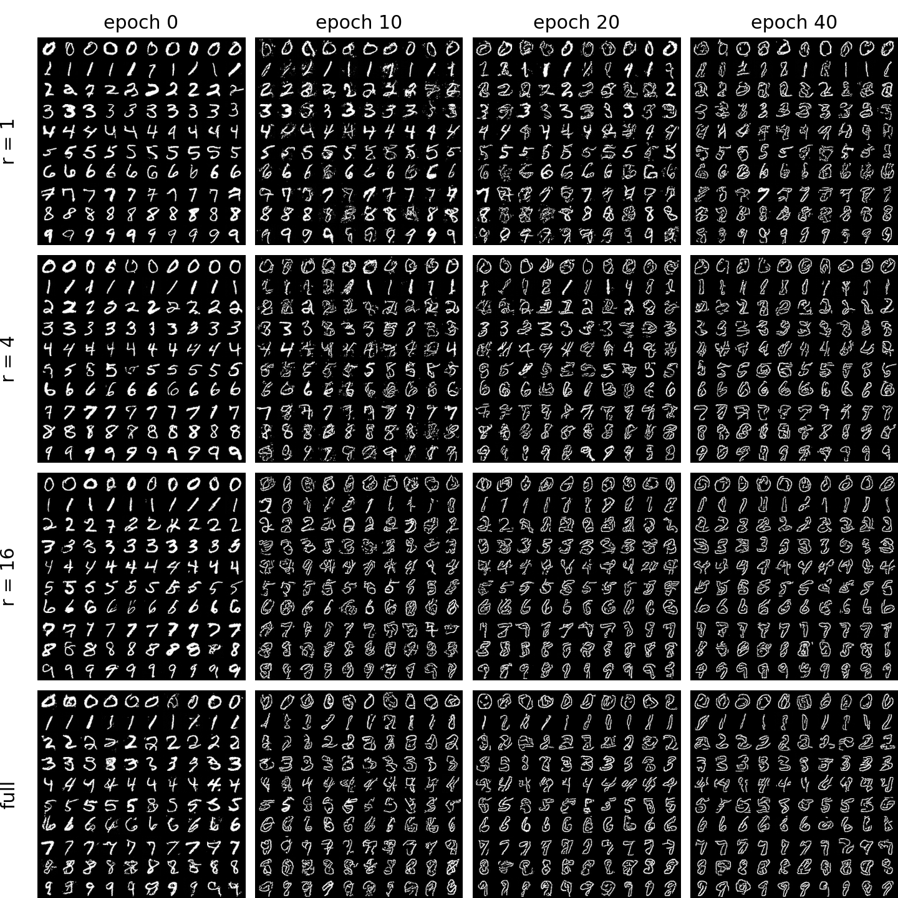
  <figcaption>Samples during fine-tuning. Lower rank adapts more slowly: at epoch 10, full fine-tuning and $r = 16$ already draw outlines, $r = 4$ is halfway, and $r = 1$ still mostly draws filled digits. Lower rank also fits less well, with messier outlines even at epoch 40.</figcaption>
</figure>

### Turning the adapter up and down

Because the update is scaled by $s$, the same adapter can be applied partially at inference time, without retraining:

<figure>
  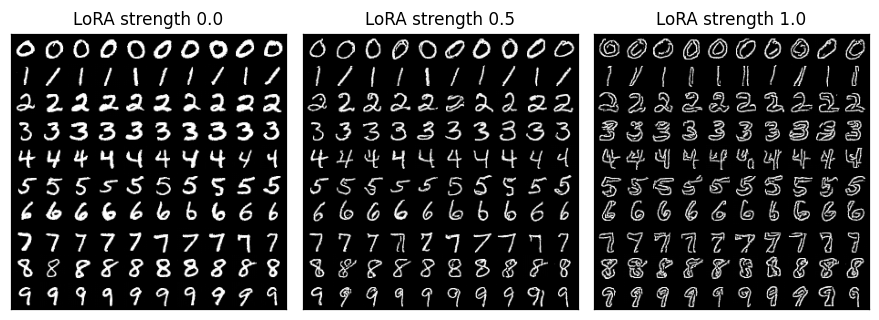
  <figcaption>LoRA $r = 4$ applied at strength $s = 0$, $0.5$ and $1$. Guidance scale 3, same initial noise.</figcaption>
</figure>

$s = 0.5$ is a genuine in-between: thin single strokes, neither filled nor outlined. This also gives a free correctness check. At $s = 0$ the output must be the base model's, and it is identical to the base model's samples **pixel for pixel**.


## Limitations

- **Only MNIST.** MNIST is an easy dataset, so the differences between methods, especially at few steps, are probably smaller here than they would be on harder data, at higher resolution, in latent space or with text conditioning.
- **Simplified implementations.** UniPC uses a simplified second-order corrector and the consistency models are written in Rectified Flow coordinates rather than EDM's.


## Try It Yourself

Writing the code took a fraction of the time. Most of it went into understanding why something that looked correct did not work, and that turned out to be where the real learning happened. 
This is what Feynman's line means in practice. Reading a paper gives you the idea. Building it, and finding out exactly why your first version fails, is what gives you the understanding.

The code is at **[github.com/liqq010/nano_diffusion](https://github.com/liqq010/nano_diffusion)**. Everything runs on a single GPU.


## Citation

If you find this post useful, please cite it as:

> Li, Quanquan. "From 1000 Steps to 1: Building Diffusion and Flow Models from Scratch." *Quanquan Li's blog*, October 9, 2026. https://liqq010.github.io/posts/nano-diffusion/

Or in BibTeX:

```bibtex
@misc{li2026nanodiffusion,
  author       = {Li, Quanquan},
  title        = {From 1000 Steps to 1: Building Diffusion and Flow Models from Scratch},
  year         = {2026},
  month        = {October},
  day          = {9},
  howpublished = {\url{https://liqq010.github.io/posts/nano-diffusion/}},
  note         = {Blog post}
}
```

## References

- **DDPM:** Ho, Jain & Abbeel. [Denoising Diffusion Probabilistic Models](https://arxiv.org/abs/2006.11239). 2020.
- **Cosine schedule:** Nichol & Dhariwal. [Improved Denoising Diffusion Probabilistic Models](https://arxiv.org/abs/2102.09672). 2021.
- **v-prediction:** Salimans & Ho. [Progressive Distillation for Fast Sampling of Diffusion Models](https://arxiv.org/abs/2202.00512). 2022.
- **DDIM:** Song, Meng & Ermon. [Denoising Diffusion Implicit Models](https://arxiv.org/abs/2010.02502). 2020.
- **DPM-Solver:** Lu et al. [DPM-Solver: A Fast ODE Solver for Diffusion Probabilistic Model Sampling in Around 10 Steps](https://arxiv.org/abs/2206.00927). 2022.
- **DPM-Solver++:** Lu et al. [DPM-Solver++: Fast Solver for Guided Sampling of Diffusion Probabilistic Models](https://arxiv.org/abs/2211.01095). 2022.
- **UniPC:** Zhao et al. [UniPC: A Unified Predictor-Corrector Framework for Fast Sampling of Diffusion Models](https://arxiv.org/abs/2302.04867). 2023.
- **Trailing grid:** Lin et al. [Common Diffusion Noise Schedules and Sample Steps are Flawed](https://arxiv.org/abs/2305.08891). 2023.
- **Heun sampler:** Karras et al. [Elucidating the Design Space of Diffusion-Based Generative Models](https://arxiv.org/abs/2206.00364). 2022.
- **Classifier-free guidance:** Ho & Salimans. [Classifier-Free Diffusion Guidance](https://arxiv.org/abs/2207.12598). 2022.
- **Rectified Flow:** Liu, Gong & Liu. [Flow Straight and Fast: Learning to Generate and Transfer Data with Rectified Flow](https://arxiv.org/abs/2209.03003). 2022.
- **Flow matching:** Lipman et al. [Flow Matching for Generative Modeling](https://arxiv.org/abs/2210.02747). 2022.
- **Logit-normal sampling, timestep shift:** Esser et al. [Scaling Rectified Flow Transformers for High-Resolution Image Synthesis](https://arxiv.org/abs/2403.03206). 2024.
- **Consistency Models:** Song et al. [Consistency Models](https://arxiv.org/abs/2303.01469). 2023.
- **Improved CT:** Song & Dhariwal. [Improved Techniques for Training Consistency Models](https://arxiv.org/abs/2310.14189). 2023.
- **MeanFlow:** Geng et al. [Mean Flows for One-step Generative Modeling](https://arxiv.org/abs/2505.13447). 2025.
- **DMD:** Yin et al. [One-step Diffusion with Distribution Matching Distillation](https://arxiv.org/abs/2311.18828). 2023.
- **DMD2:** Yin et al. [Improved Distribution Matching Distillation for Fast Image Synthesis](https://arxiv.org/abs/2405.14867). 2024.
- **DiT:** Peebles & Xie. [Scalable Diffusion Models with Transformers](https://arxiv.org/abs/2212.09748). 2022.
- **LoRA:** Hu et al. [LoRA: Low-Rank Adaptation of Large Language Models](https://arxiv.org/abs/2106.09685). 2021.
